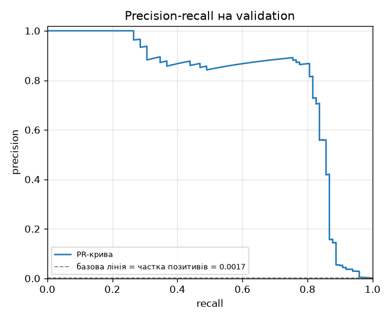
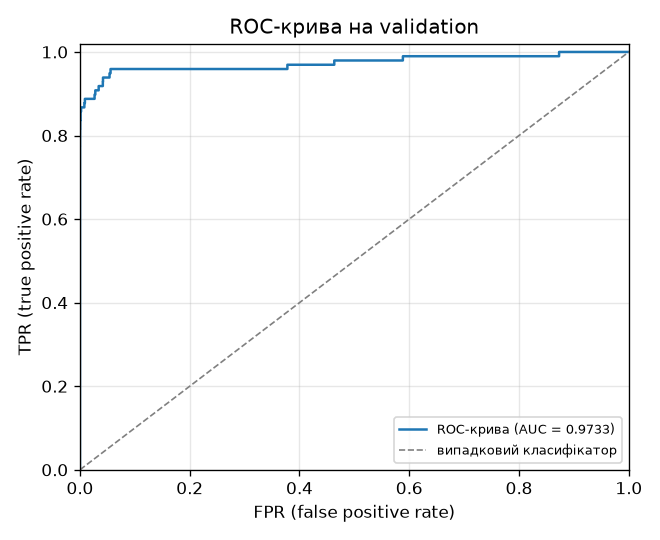

# ЛР2. Поріг рішення під асиметричну ціну помилок

## Запуск

Набір даних: [Kaggle — Credit Card Fraud Detection (`mlg-ulb/creditcardfraud`)](https://www.kaggle.com/datasets/mlg-ulb/creditcardfraud).
Файл `creditcard.csv` (~150 МБ) до репозиторію не додаємо — для доступу
потрібен обліковий запис Kaggle. Шлях передається аргументом команди.

```bash
# повторне навчання у нову теку (results/ уже заповнена, а стартовий код
# відмовляється писати в непорожню теку)
uv run python lab2_starter.py --data /шлях/до/creditcard.csv --out results_rerun

# аналіз зі збережених прогнозів, без CSV і без повторного навчання
uv run python main.py
```

`main.py` завжди читає збережені прогнози з `results/predictions.npz`, тому
для перевірки чисел із README повторне навчання не потрібне. Прогнози в
`results/` отримані командою з `--out results` ще до того, як тека була
заповнена.

`main.py` перезаписує лише свої результати (таблиці, графіки, звіти);
`model.pt`, `predictions.npz`, `preprocessing.npz`, `run.json` та
`split_summary.csv`, збережені під час навчання, не чіпаються.

## Структура

| Файл | Що в ньому |
|---|---|
| `lab2_starter.py` | Стартовий код викладача: поділ, StandardScaler, навчання 12 епох, збереження прогнозів |
| `metrics.py` | `confusion(y, s, t)` за правилом `s >= t`; `cost(fn, fp) = 10·FN + FP`; `precision/recall` з обробкою нульового знаменника |
| `threshold.py` | Швидкий пошук порога: кандидати (унікальні оцінки + `+inf`), сортування та кумулятивні суми, O(n log n); правило розвʼязання нічиєї |
| `checks.py` | Повільний прямий перебір і три набори з умови (A, B, C) |
| `main.py` | Оркестрація Етапів 2–4: читає `results/predictions.npz`, пише таблиці, PR/ROC-графіки, звіти |
| `results/` | Збережені ваги, прогнози, таблиці, графіки, JSON з t\* |

## Дані та поділ

- Усього 284 807 транзакцій, 492 шахрайські (0.172%).
- 29 ознак: `V1…V28` та `Amount`. `Class` і `Time` до моделі не включаємо.
  Сире `Amount` зберігаємо окремо для розбору FP/FN.
- Поділ **60/20/20**, стратифікований за `Class`, `random_state=0`:
  спочатку `train_test_split` з `test_size=0.4`, потім половина відкладеного —
  `validation`, інша — `test`.
- `StandardScaler.fit` викликається **лише на train**; статистики
  застосовуються до validation і test (пояснення — у розділі 1 теорії).
- Масиви для PyTorch — `float32`. Класи не балансуються.

| split      | n       | positives | positive_fraction |
|------------|---------|-----------|-------------------|
| train      | 170 884 | 295       | 0.001726 |
| validation |  56 961 |  98       | 0.001720 |
| test       |  56 962 |  99       | 0.001738 |

Частки позитивів у трьох поділах майже однакові — стратифікація спрацювала.

## Теорія та формули

### 1. Оцінки та стандартизація

Модель видає логіт $`z_i`$; оцінка шахрайства —
$`s_i = \sigma(z_i) = 1 / (1 + e^{-z_i}) \in (0, 1)`$.

Стандартизацію ознак рахуємо **лише на train** і застосовуємо до validation
та test:

```math
x' = \frac{x - \mu_{\text{train}}}{\sigma_{\text{train}}}.
```

Якщо $`\mu, \sigma`$ порахувати на всьому наборі, вони «знатимуть» про
validation і test, і будь-яка оцінка узагальнення стане оптимістичною —
модель фактично побачить статистику майбутнього, якого на етапі навчання
не повинна знати.

### 2. Правило рішення й лічильники

Для порога $`t`$:

```math
\hat y_i(t) = \mathbf{1}[s_i \ge t].
```

Лічильники матриці плутанини — суми індикаторів:

```math
TP(t) = \sum_{i} \mathbf{1}[s_i \ge t,\ y_i = 1], \qquad FP(t) = \sum_{i} \mathbf{1}[s_i \ge t,\ y_i = 0],
```

```math
FN(t) = \sum_{i} \mathbf{1}[s_i < t,\ y_i = 1], \qquad TN(t) = \sum_{i} \mathbf{1}[s_i < t,\ y_i = 0].
```

Прямі тотожності: $`TP + FN = P`$ (кількість позитивів у вибірці),
$`FP + TN = N - P`$ (кількість негативів), сума всіх чотирьох завжди
дорівнює $`N`$ — розміру вибірки.

### 3. Вартість, precision, recall

Асиметрична вартість помилок і стандартні метрики:

```math
C(t) = 10 \cdot FN(t) + FP(t), \qquad \text{precision}(t) = \frac{TP}{TP + FP}, \qquad \text{recall}(t) = \frac{TP}{TP + FN}.
```

`Amount` у $`C`$ не входить — завдання фіксує саме цю формулу. Precision
не визначена при $`TP + FP = 0`$ (жодного прогнозованого позитива); recall —
при $`TP + FN = 0`$ (у вибірці немає позитивів). В обох випадках пишемо
«не визначено», а не 0 чи 1: ділити на нуль не можна, а підміна значенням
приховувала б факт відсутності прикладів.

### 4. Множина кандидатів порогів

Функція $`C(t)`$ **кусково-стала**: між сусідніми унікальними оцінками
жоден приклад не перетинає поріг, тож усі лічильники однакові. Нехай
$`u_1 \lt  u_2 \lt  \dots \lt  u_m`$ — унікальні оцінки на validation. Тоді для
будь-якого $`t \in (u_{k-1}, u_k]`$ прогнози збігаються з прогнозами при
$`t = u_k`$ (беремо правий кінець через правило $`s \ge t`$). Крайні випадки:
$`t \le u_1`$ означає «усі позитивні», а $`t \gt  u_m`$ (зокрема $`t = +\infty`$) —
«усі негативні». Отже, перевіряти досить скінченну множину:

```math
T = \lbrace u_1,\, u_2,\, \dots,\, u_m,\, +\infty \rbrace.
```

Рівні оцінки природно потрапляють в один клас: $`s_i = s_j = u_k`$ дають
однаковий прогноз, тому в $`T`$ одна точка на всю групу.

### 5. Підрахунок через суфіксні суми

Позначимо $`n_k = \lvert \lbrace i : s_i = u_k \rbrace \rvert`$ (скільки
прикладів мають оцінку $`u_k`$) і $`p_k = \lvert \lbrace i : s_i = u_k,\, y_i = 1 \rbrace \rvert`$
(скільки серед них позитивних). Для $`t = u_k`$ позитивні прогнози — це
саме приклади з оцінками $`u_k, u_{k+1}, \dots, u_m`$, тож:

```math
TP(u_k) = \sum_{j \ge k} p_j, \qquad FP(u_k) = \sum_{j \ge k} (n_j - p_j),
```

```math
FN(u_k) = P - TP(u_k), \qquad TN(u_k) = (N - P) - FP(u_k).
```

Для $`t = +\infty`$ окремо: $`TP = FP = 0`$, $`FN = P`$, $`TN = N - P`$, тож

```math
C(+\infty) = 10 \cdot P.
```

Суфіксні суми $`\sum_{j \ge k}`$ рахуються одним `np.cumsum` справа наліво.
Складність: одне сортування $`O(n \log n)`$ плюс лінійний обхід $`O(m)`$,
$`m \le n`$. Повного проходу $`O(nm)`$ по вибірці для кожного порога
**не робимо** — цим реалізація відрізняється від перевірочного
прямого перебору з Етапу 3.

### 6. Правило нічиєї

Шуканий поріг — найбільший серед точок мінімуму:

```math
t^{\ast} = \max \Bigl\lbrace t \in T : C(t) = \min_{t' \in T} C(t') \Bigr\rbrace.
```

Чому «найбільший»: вищий поріг — менш охочий класифікувати як шахрайство,
тож дає менше FP при тій самій вартості. За рівного $`C`$ це консервативніше
рішення з меншою кількістю хибних тривог.

### 7. Чому висока ROC-AUC не гарантує precision

Нехай $`\pi = P / N`$ — частка позитивів у вибірці, $`TPR = TP / P`$,
$`FPR = FP / (N - P)`$. Тоді для будь-якого фіксованого порога:

```math
\text{precision} = \frac{TP}{TP + FP} = \frac{TPR \cdot \pi}{TPR \cdot \pi + FPR \cdot (1 - \pi)}.
```

Підставимо фактичні числа з `results/` при $`t = t^{\ast}`$ на validation:
$`\pi = 98 / 56{,}961 \approx 0.001720`$, $`TPR = 82 / 98 \approx 0.8367`$,
$`FPR = 34 / 56{,}863 \approx 5.979 \times 10^{-4}`$. Чисельник
$`TPR \cdot \pi \approx 1.439 \times 10^{-3}`$, другий доданок знаменника
$`FPR \cdot (1 - \pi) \approx 5.969 \times 10^{-4}`$, тож
$`\text{precision} \approx 0.001439 / 0.002036 \approx 0.707`$ — та сама
цифра, що й $`TP/(TP + FP) = 82/116 \approx 0.7069`$.

Тобто навіть при $`FPR \approx 6 \times 10^{-4}`$ (ROC виглядає чудово)
кількість FP ($`\approx 34`$) порівнянна з TP ($`\approx 82`$) — усе через
маленьке $`\pi`$. ROC-AUC $`= 0.973`$ усереднює $`TPR`$ проти $`FPR`$ по всіх
порогах і цієї асиметрії шкал не бачить.

### 8. Теоретичний поріг для каліброваних ймовірностей

Якщо $`s`$ — калібрована ймовірність шахрайства, прогноз «позитив» вигідний,
коли очікувана ціна хибної тривоги не більша за очікувану ціну пропуску:
$`c_{FP}(1 - p) \le c_{FN}\,p`$, звідки

```math
\tau^{\ast} = \frac{c_{FP}}{c_{FP} + c_{FN}} = \frac{1}{11} \approx 0.0909.
```

Наш $`t^{\ast} \approx 0.0312`$ нижчий, але некаліброваності це не доводить:
при 98 позитивах мінімум $`C`$ визначають окремі приклади. Оцінка $`t^{\ast}`$
належить самій шахрайській транзакції, тож підняття порога на один кандидат
робить її FN ($`C`$: 194 → 204), а опускання додає один FP ($`C = 195`$).
Перевірити калібрування можна лише reliability-кривою.

### 9. Відстань у логітах

```math
\mathrm{logit}(p) = \ln \frac{p}{1 - p}, \qquad \Delta_{\text{logit}}(i) = \mathrm{logit}(s_i) - \mathrm{logit}(t^{\ast}).
```

У ймовірностях усі FN лежать у вузькій смузі $`(-t^{\ast},\, 0) \approx (-0.031,\, 0)`$,
тож виглядають «однаково близько» до порога. У логітах цього обмеження немає:
$`s = 0.0005`$ дає $`\Delta_{\text{prob}} \approx -0.031`$, але
$`\Delta_{\text{logit}} \approx -4.16`$, тобто модель помилилась дуже впевнено.

## Пошук порога: реалізація

Теоретичні формули — вище. Тут про те, як алгоритм з розділів 4–5
переводиться на `numpy`, і як гарантуємо побітову відтворюваність CSV.

**Групування і суми.** `np.unique(scores, return_inverse=True)` дає
відсортовані унікальні оцінки й індекси. `np.bincount` на цих індексах
(з вагами $`y`$ і без) дає $`n_k`$ та $`p_k`$. Суфіксні суми — `np.cumsum`
на розгорнутих масивах. Для $`t = +\infty`$ лічильники додаємо окремим
рядком.

**float32.** Оцінки збережені як `float32` і розширюються до `float64`
без втрат. Поріг у CSV пишемо через `repr(float)` і читаємо з
`float_precision="round_trip"`. `validate_csv_integrity` у `main.py`
перевіряє, що всі пороги в CSV побітово збігаються з обчисленими і що рядок
$`t^{\ast}`$ має ті самі лічильники, що й окремий виклик `confusion`.

## Validation: криві і таблиця

ROC-AUC = **0.973318**.



Пунктирна лінія — базова `precision = частка позитивів ≈ 0.001720`:
стільки має PR-крива у випадкового класифікатора з такою ж часткою
позитивів. Крива PR значно вища базової — модель виразно відрізняє класи.



Висока ROC-AUC **не** гарантує малої $`C`$ чи високої precision: AUC
усереднює $`TPR`$ проти $`FPR`$ по всіх порогах і від $`t`$ не залежить, а
при частці позитивів $`\pi \approx 0.17\%`$ навіть мала $`FPR`$ дає помітну
кількість FP (обчислення на наших числах — розділ 7 теорії).

**Поріг $`t^{\ast} = 0.031193967908620834`$** (мінімум $`C`$ на validation $`= 194`$).

| Правило на validation | Поріг | TP | FP | FN | TN | C | precision | recall |
|---|---|---|---|---|---|---|---|---|
| Стандартний поріг | $`0.5`$ | 71 | 9 | 27 | 56 854 | 279 | 0.887500 | 0.724490 |
| Мінімум вартості  | $`0.031193967908620834`$ | 82 | 34 | 16 | 56 829 | **194** | 0.706897 | 0.836735 |
| Усі негативні     | $`+\infty`$ | 0 | 0 | 98 | 56 863 | 980 | не визначено | 0.000000 |

Повна таблиця кандидатів — `results/validation_thresholds.csv` (55 956 рядків),
стислий `.md` з цими трьома рядками — `results/validation_summary.md`,
JSON із $`t^{\ast}`$ — `results/threshold.json`.

Перехід з $`t = 0.5`$ на $`t^{\ast} \approx 0.0312`$:
$`\Delta FN = -11`$ (з 27 до 16), $`\Delta FP = +25`$ (з 9 до 34), $`C`$ падає
з 279 до 194. Один пропущений шахрай «коштує» 10 хибних тривог, тож
такий обмін вигідний.

## Перевірка пошуку порога (Етап 3)

Швидкий алгоритм звіряю з прямим перебором: для кожного кандидата
`checks.slow_table` окремо застосовує правило $`s_i \ge t`$ до всіх
прикладів і рахує матрицю плутанини. Повільний перебір не використовує
жодного результату чи функції швидкого алгоритму — лише спільне
визначення списку кандидатів $`T`$. На всіх трьох наборах лічильники та
$`C`$ збігаються точно, обраний $`t^{\ast}`$ однаковий.

| Набір | Що перевіряє | $`t^{\ast}`$ (fast) | $`t^{\ast}`$ (slow) | Збіг |
|---|---|---|---|---|
| A | рівні оцінки $`0.7`$ → однаковий прогноз | $`0.4`$ | $`0.4`$ | так |
| B | жодної позитивної мітки → мінімум $`C`$ на $`+\infty`$ | $`+\infty`$ | $`+\infty`$ | так |
| C | два кандидати $`0.5`$ і $`0.8`$ з однаковою $`C = 10`$ → беремо більший | $`0.8`$ | $`0.8`$ | так |

У швидкому методі $`t^{\ast}`$ беремо через `threshold.best_threshold` (та
сама функція, що в `main.py`). У повільному — через незалежний
Python-цикл `checks.slow_best`: виграє менша $`C`$, при рівній — більший
поріг. Повні CSV обох методів: `results/search_check_{A,B,C}_{fast,slow}.csv`.

**Набір A**: $`s = [0.9, 0.7, 0.7, 0.4, 0.2, 0.1]`$, $`y = [0, 1, 0, 1, 0, 0]`$.
Унікальні оцінки: $`0.1, 0.2, 0.4, 0.7, 0.9`$. Дві $`0.7`$-оцінки (одна з
$`y = 1`$, друга з $`y = 0`$) завжди опиняються з одного боку порога, бо
між ними немає проміжного кандидата. При $`t = 0.7`$ обидві прогнозуються
позитивними ($`TP = 1`$, $`FP = 2`$; $`FN = 1`$ тут дає приклад $`s = 0.4`$ з
$`y = 1`$). При переході до $`t = 0.9`$ обидві $`0.7`$-оцінки одночасно
стають негативними: за один крок $`TP\colon 1 \to 0`$ і $`FP\colon 2 \to 1`$.
Саме це перевіряємо: рівні оцінки отримують однаковий прогноз, і не
існує порога, який розділив би їх.

| поріг | TP | FP | FN | TN | C |
|---|---|---|---|---|---|
| $`0.1`$ | 2 | 4 | 0 | 0 | 4 |
| $`0.2`$ | 2 | 3 | 0 | 1 | 3 |
| $`0.4`$ | 2 | 2 | 0 | 2 | **2** |
| $`0.7`$ | 1 | 2 | 1 | 2 | 12 |
| $`0.9`$ | 0 | 1 | 2 | 3 | 21 |
| $`+\infty`$ | 0 | 0 | 2 | 4 | 20 |

Мінімум $`C = 2`$ унікальний ($`t^{\ast} = 0.4`$).

**Набір B**: $`s = [0.9, 0.6, 0.3]`$, $`y = [0, 0, 0]`$. Жодної позитивної
мітки → $`TP = FN = 0`$ для будь-якого $`t`$, тож $`C = FP`$. $`FP`$ монотонно
падає від 3 до 0. Мінімум $`C = 0`$ досягається тільки на $`+\infty`$ —
модель, яка нічого не прогнозує позитивним, оптимальна.

| поріг | TP | FP | FN | TN | C |
|---|---|---|---|---|---|
| $`0.3`$ | 0 | 3 | 0 | 0 | 3 |
| $`0.6`$ | 0 | 2 | 0 | 1 | 2 |
| $`0.9`$ | 0 | 1 | 0 | 2 | 1 |
| $`+\infty`$ | 0 | 0 | 0 | 3 | **0** |

**Набір C**: $`s = [0.8, \underbrace{0.5, \dots, 0.5}_{11}, 0.2]`$,
$`y = [1, 1, \underbrace{0, \dots, 0}_{10}, 0]`$. Групи рівних оцінок
$`(n_k, p_k)`$: $`(1, 0)`$ для $`0.2`$, $`(11, 1)`$ для $`0.5`$, $`(1, 1)`$ для $`0.8`$.

| поріг | TP | FP | FN | TN | C |
|---|---|---|---|---|---|
| $`0.2`$ | 2 | 11 | 0 | 0 | 11 |
| $`0.5`$ | 2 | 10 | 0 | 1 | **10** |
| $`0.8`$ | 1 | 0  | 1 | 11 | **10** |
| $`+\infty`$ | 0 | 0 | 2 | 11 | 20 |

Два кандидати $`0.5`$ і $`0.8`$ дають однакову $`C = 10`$ (нічия): при
$`t = 0.5`$ ловимо обидва позитиви ціною 10 FP; при $`t = 0.8`$ пропускаємо
$`0.5`$-позитив ($`FN = 1`$, внесок $`10 \cdot FN = 10`$), зате жодного FP. Правило
«найбільший поріг серед мінімумів» → $`t^{\ast} = 0.8`$.

## Тест (Етап 4)

Поріг $`t^{\ast}`$ зафіксовано на validation **до** цього пункту; до test
ми переходимо лише після того, як усі три перевірки Етапу 3 пройшли
точно.

| TP | FP | FN | TN | C | precision | recall |
|---|---|---|---|---|---|---|
| 80 | 43 | 19 | 56 820 | **233** | 0.650407 | 0.808081 |

($`C_{\text{test}} = 233`$ проти $`C_{\text{validation}} = 194`$ — приблизно $`+20\%`$.)

### Перші 5 FP і 5 FN за номером рядка CSV

$`\Delta_{\text{prob}} = s - t^{\ast}`$, $`\Delta_{\text{logit}} = \mathrm{logit}(s) - \mathrm{logit}(t^{\ast})`$
(чому порівнюємо в логітах — розділ 9 теорії).

| CSV-рядок | Тип | Мітка | Оцінка | Amount | Δ_prob | Δ_logit |
|---|---|---|---|---|---|---|
|   460 | FP | 0 | 0.196159 |   2.00 | +0.164965 | +2.025 |
|  2961 | FP | 0 | 0.080961 |   2.49 | +0.049767 | +1.006 |
| 10783 | FP | 0 | 0.966327 |  89.99 | +0.935133 | +6.793 |
| 13405 | FP | 0 | 0.932032 |  89.99 | +0.900838 | +6.054 |
| 13617 | FP | 0 | 0.922762 |  89.99 | +0.891568 | +5.916 |
| 10497 | FN | 1 | 0.011464 |   3.79 | −0.019730 | −1.021 |
| 52521 | FN | 1 | 0.006373 | 105.99 | −0.024821 | −1.613 |
| 55401 | FN | 1 | 0.005642 |   1.00 | −0.025552 | −1.736 |
| 91671 | FN | 1 | 0.000500 | 290.18 | −0.030694 | −4.164 |
| 93486 | FN | 1 | 0.018352 |   0.00 | −0.012842 | −0.544 |

(Також у `results/test_errors.csv` з повною точністю.)

**Що видно з 10 прикладів у шкалі логітів.**
- Найупевненіші **FP** — три рядки 10783 / 13405 / 13617
  ($`\Delta_{\text{logit}} = +6.79 / +6.05 / +5.92`$): модель була впевнена,
  що це шахрайство, але це легітимні транзакції. Три однакові
  `Amount = 89.99` — скоріше збіг у малій вибірці перших 5 за індексом,
  ніж висновок. Два інші FP (460 і 2961) ближчі до порога
  ($`\Delta_{\text{logit}} = +2.03 / +1.01`$).
- Найупевненіший **FN** — 91671 ($`\Delta_{\text{logit}} = -4.16`$):
  модель дуже впевнено сказала «не шахрайство», а це шахрайство на 290.18.
  Решта FN лежать у смузі $`-1.74 \ldots -0.54`$ логітів — ближче до
  порога, ніж більшість FP.
- Якщо опустити поріг нижче, щоб вловити «близькі» FN
  ($`-0.54 \ldots -1.74`$), доведеться прийняти ще якусь кількість FP із
  тієї самої смуги, але далеку помилку 91671 так не виправиш — для неї
  модель видала майже нульову оцінку.
- `Amount` для FN сильно відрізняється: 0, 1.00, 3.79, 105.99, 290.18.
  За 10 прикладами ніякої закономірності «великі суми частіше
  пропускаються» (чи навпаки) **не видно**. Для надійних причин треба
  аналізувати всю множину FP/FN (62 помилки) у розрізі ознак $`V_1 \ldots V_{28}`$.

## Висновки

1. **Що змінив вибір порога за незмінної моделі.** Та сама модель із
   $`t = 0.5`$ давала на validation $`C = 279`$ (27 FN, 9 FP). Поріг
   $`t^{\ast} \approx 0.0312`$ знижує $`C`$ до 194 (16 FN, 34 FP). Ціна
   рішення в термінах FP і FN: $`\Delta FN = -11`$, $`\Delta FP = +25`$;
   оскільки один FN коштує як 10 FP, чистий виграш
   $`11 \cdot 10 - 25 = 85`$ і покриває різницю.
2. **ROC-AUC vs $`C`$.** ROC-AUC $`= 0.973`$ — висока, але вона описує
   порядок оцінок, а не вартість помилок при фіксованому $`t`$. Для
   асиметричної $`C`$ треба явно шукати мінімум по кандидатах.
3. **Чому $`t^{\ast}`$ не дорівнює $`1/11`$.** Для каліброваних ймовірностей
   оптимальним був би поріг $`\tau^{\ast} = 1/11 \approx 0.091`$ (розділ 8 теорії),
   а наш $`t^{\ast} \approx 0.031`$ нижчий. Це не доводить некаліброваності:
   при 98 позитивах положення мінімуму $`C`$ визначають окремі приклади.
4. **Validation $`\ne`$ test.** $`C_{\text{validation}} = 194`$,
   $`C_{\text{test}} = 233`$ ($`+20\%`$). Два чинники:
   - Мінімум по $`\sim 56`$ тис. кандидатах на validation **оптимістично
     зміщений**: ми вибираємо найкращу з багатьох точок, і випадкова
     удача на малій вибірці позитивів (98) працює на нас.
   - У шкалі $`C = 10 \cdot FN + FP`$ кожен FN важить $`10`$ FP, тож навіть
     1–2 додаткові FN на test легко роблять $`C`$ помітно гіршою; саме це
     тут і сталось ($`FN\colon 16 \to 19`$, $`FP\colon 34 \to 43`$).
5. **Робочий висновок.** Поріг $`t = 0.5`$ для цієї задачі — поганий
   default: він оптимізує щось на кшталт accuracy, тоді як бізнес-ціна
   різна для двох типів помилок. Правильний поріг завжди залежить від
   того, скільки «коштує» FN проти FP, і підбирати його треба на
   validation, прийнявши, що на test значення $`C`$ буде трохи гірше.

## Відтворюваність

Для перевірки повторне навчання `lab2_starter.py` на тому самому
`creditcard.csv` я зберегла в окрему теку і порівняла з уже наявним
`results/predictions.npz`:

- `train_row_ids`, `validation_row_ids`, `test_row_ids` — побітова рівність
  (поділ `train_test_split` зі `stratify` і `random_state=0` детермінований);
- `StandardScaler.mean_` і `StandardScaler.scale_` — побітова рівність
  (scaler навчається тільки на `train`, цей набір сам детермінований);
- `max |s_validation − s'_validation| = 0.0` — не просто малий поріг
  похибки, а точний нуль; у цьому середовищі (`torch==2.14.1+cpu`,
  `numpy==2.5.4` на CPU) оцінки сигмоїди відтворюються до біта.

Так само `uv run python main.py` зі збережених прогнозів дає ті самі
`t*`, лічильники, `C` і таблицю помилок, що в README (мінімум $`C`$ на
validation = 194, test $`C = 233`$).

## Джерела

- Лекція 2 курсу («Поріг рішення під асиметричну ціну помилок»), розділ 12 — визначення
  кандидатів, обробка рівних оцінок, правило розвʼязання нічиєї.
- Лекція 3 курсу — метрики якості (PR, ROC, AUC).
- Стартовий код викладача `lab2_starter.py` (модель, цикл навчання, збереження).
- Набір даних: Kaggle `mlg-ulb/creditcardfraud` (Credit Card Fraud Detection).
- Як допоміжний інструмент для написання та оформлення коду використано Claude.
