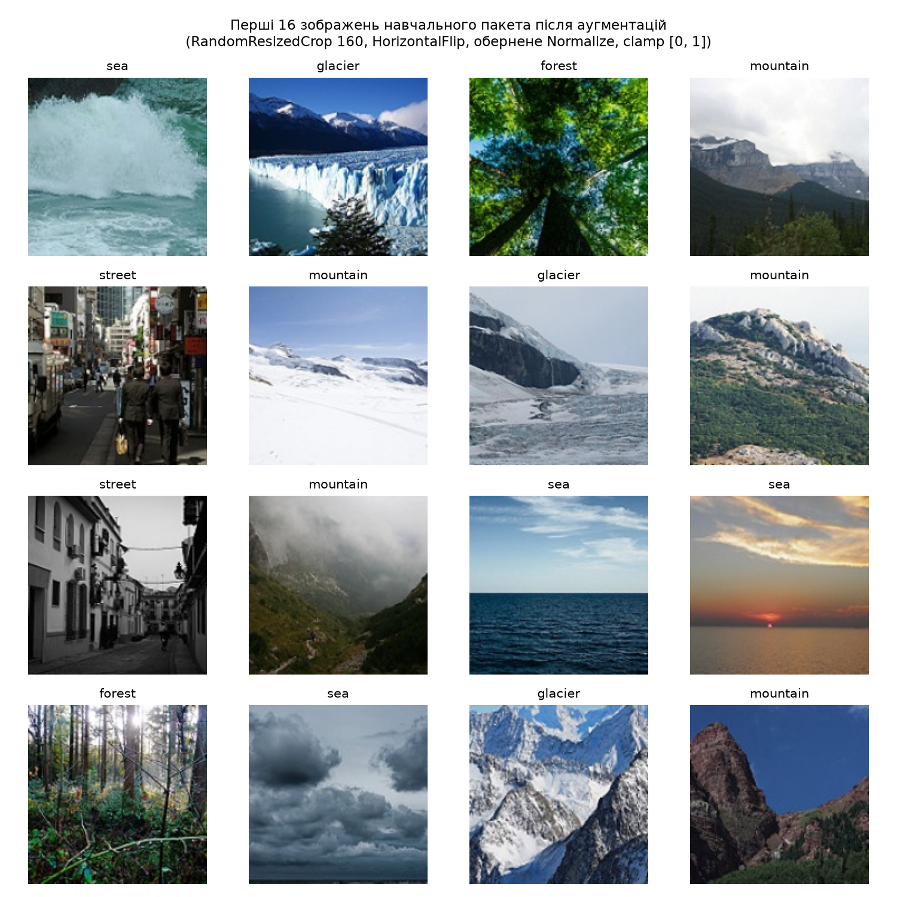
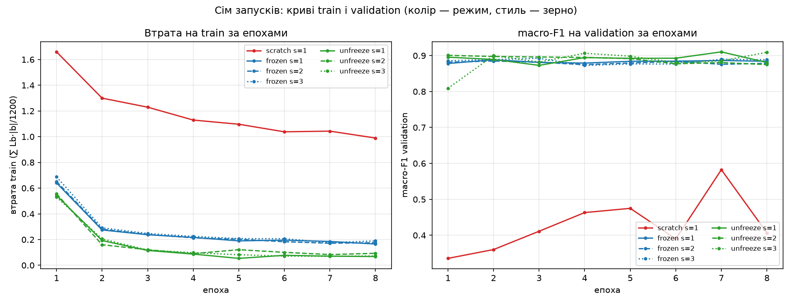
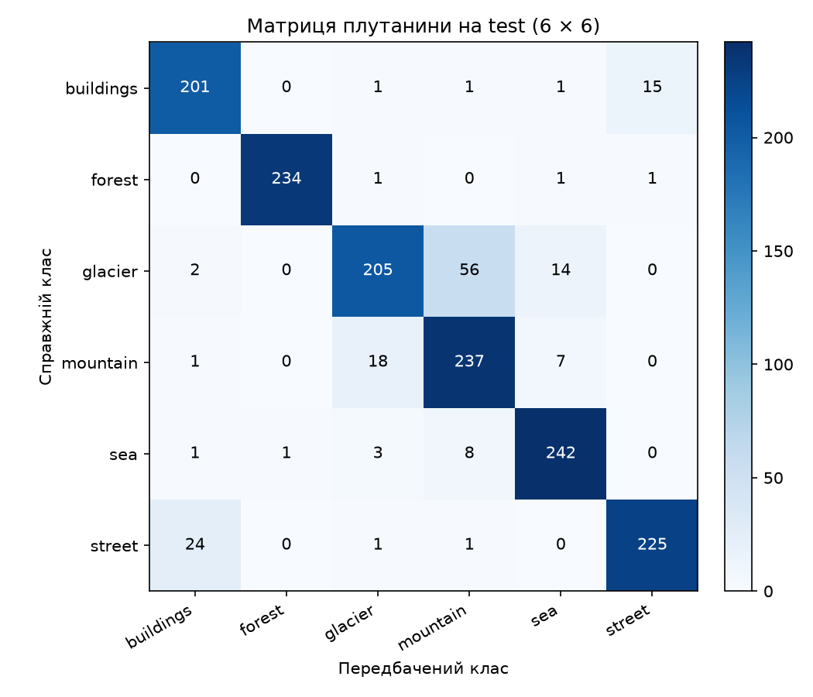
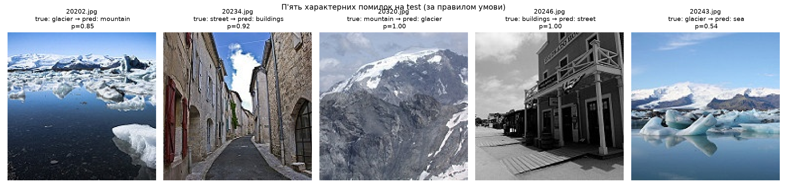

# ЛР3. Обчислювальний експеримент і трансферне навчання

## Запуск

Набір даних — [Intel Image Classification](https://www.kaggle.com/datasets/puneet6060/intel-image-classification) на Kaggle. Потрібні лише теки `seg_train/` і `seg_test/`, `seg_pred/` не використовується. Я завантажувала набір так і потім переклала обидві теки в `~/data/intel/`:

```bash
uvx --with kagglehub python -c "import kagglehub; print(kagglehub.dataset_download('puneet6060/intel-image-classification'))"
```

Запуск:

```bash
uv run python train.py --data ~/data/intel     # навчання
uv run python analyze.py --data ~/data/intel   # аналіз і test
```

`train.py` будує поділ, робить перевірки пунктів 1–2, сім запусків і зберігає `lab3_model.pt`; test він не відкриває. `analyze.py` перевіряє хеш `split.csv` у журналах, будує таблиці й криві зі збережених журналів, перевіряє вибір моделі і один раз оцінює її на test на CPU.

`lab3_model.pt` (43 МБ) лежить у [Release `lab3`](https://github.com/ivanna-vasylchuk/deepl_labs/releases/tag/lab3), бо через браузер GitHub не приймає файли більші за 25 МБ. Перед `analyze.py` його треба покласти в `lab3/`.

У мене (WSL2, GTX 1650 Ti) навчання триває близько 6 хвилин, аналіз — близько хвилини. Ваги ImageNet при першому запуску завантажуються в кеш torch. На Linux і Windows встановлюється CUDA-збірка torch (без відеокарти вона просто працює на CPU), на macOS Apple Silicon — звичайна з PyPI; `train.py` сам обирає `cuda`, `mps` або `cpu`. На CPU навчання триває помітно довше.

## Структура

| Файл | Що в ньому |
|---|---|
| `pyproject.toml`, `uv.lock`, `.python-version` | Залежності з фіксованими версіями (Python 3.12, torch 2.6.0, torchvision 0.21.0 та ін.) |
| `config.py` | Константи: класи, mean/std, розмір 160, гіперпараметри, модулі в `eval()` для кожного режиму, зерна |
| `data.py` | Поділ (`build_split`), контрольна таблиця (`control_table`), датасет, перетворення, завантажувачі |
| `model.py` | Побудова моделі (`build_model`), `set_train_mode`, оптимізатор із групами (`make_optimizer`) |
| `engine.py` | Цикл навчання одного запуску, оцінка на validation, запис `run.json` і `val_logits.npy` |
| `checks.py` | Перевірки пунктів 1–2: рисунок пакета, L0, параметри, що змінюється за 5 кроків, дослід із BN |
| `selection.py` | Правило вибору режиму й запуску за validation |
| `train.py` | Команда навчання |
| `analyze.py` | Команда аналізу; test відкривається тільки тут |
| `test_eval.py` | Оцінка `lab3_model.pt` на test на CPU (викликається з `analyze.py`) |
| `measure_time.py` | Окремий замір часу епохи (завантажувач і навчання по режимах) |
| `split.csv` | Поділ: 4200 рядків `file,label,part` |
| `runs/` | Для кожного з семи запусків `run.json` і `val_logits.npy` (1498 × 6) |
| `figures/` | `batch.png`, `curves.png`, `confusion.png`, `errors.png` |
| `results/` | Звіти перевірок і аналізу (`*.md`, `analysis.json`) |
| `lab3_model.pt` | Ваги вибраного запуску; лежить у [Release `lab3`](https://github.com/ivanna-vasylchuk/deepl_labs/releases/tag/lab3) |

## Дані та поділ

Процедура з умови (детальна у `data.py::build_split`):

1. Для кожного класу — `sorted()` імен файлів з його теки (рядковий порядок, як у `ImageFolder`): `0.jpg, 10006.jpg, 1001.jpg, …`.
2. **train**: один `np.random.default_rng(0)` на всі класи у фіксованому порядку. `idx = np.arange(n_k); rng.shuffle(idx)`; у train ідуть файли `idx[:200]` відсортованого списку → 1 200 зображень.
3. **validation + test**: новий `np.random.default_rng(0)`, той самий прохід по класах у `seg_test`. `cut = n_k // 2`; `idx[:cut]` → validation, `idx[cut:]` → test.

Контрольна таблиця — «кількість / сума числових імен файлів» (`20057.jpg → 20057`), `✓` — збіг з еталоном умови (повний звіт у `results/split_check.md`):

| Клас | train | validation | test |
|---|---|---|---|
| `buildings` | 200 / 1 996 761 ✓ | 218 / 4 837 323 ✓ | 219 / 4 837 559 ✓ |
| `forest` | 200 / 2 032 625 ✓ | 237 / 5 276 962 ✓ | 237 / 5 291 326 ✓ |
| `glacier` | 200 / 2 183 923 ✓ | 276 / 6 135 652 ✓ | 277 / 6 157 250 ✓ |
| `mountain` | 200 / 1 950 345 ✓ | 262 / 5 789 535 ✓ | 263 / 5 849 765 ✓ |
| `sea` | 200 / 1 987 613 ✓ | 255 / 5 655 068 ✓ | 255 / 5 668 011 ✓ |
| `street` | 200 / 1 841 817 ✓ | 250 / 5 541 845 ✓ | 251 / 5 547 533 ✓ |
| **Разом** | **1200 / 11 993 084** ✓ | **1498 / 33 236 385** ✓ | **1502 / 33 351 444** ✓ |

Усі 18 клітинок і 3 підсумки збіглися. `train ∩ validation = train ∩ test = validation ∩ test = ∅` (за іменами файлів). Усі 4 200 імен у `split.csv` унікальні — імена в наборі Intel глобально унікальні (14 034 у `seg_train`, 3 000 у `seg_test`, між теками не перетинаються).

- `split.csv` SHA-256: `b29c53c7e41b0c4bb36e54d8ca3a9bcbac11eca96abeab8ba4fbcf5937a160b8` (однаковий у всіх семи `run.json`).

## Теорія та формули

### 1. BN і ковзні статистики

`BatchNorm2d` зберігає буфери `running_mean`, `running_var` і параметри `γ, β`. У режимі `train()` на `forward` обчислюються статистики поточного пакета (per-channel), нормування йде ними, а потім відбувається експоненціальне згладжування:

```math
r \leftarrow (1 - m)\,r \;+\; m\,b, \qquad m = 0{,}1,\ b = \text{batch stat}.
```

У режимі `eval()` BN НЕ оновлює буфери і нормує саме за `running_*`. Прапор `self.training`, яким керує `.train()`/`.eval()`, не залежить від `requires_grad`: буфери — не параметри. Тому у заморожених шарах кістяка одного `requires_grad=False` недостатньо; треба явно викликати `.eval()` на цих модулях — `set_train_mode(model, regime)` робить `model.train()`, а потім `.eval()` для модулів зі стовпця «У eval()».

### 2. Дискримінативні швидкості навчання

У `unfreeze` голова `fc` вчиться з `lr = 3·10⁻³`, а `layer4` — з `lr = 3·10⁻⁴` (у 10 разів менше). Випадкова голова на старті дає великий неінформативний градієнт, який «тягне» кістяк у шумному напрямі; менший `lr` у `layer4` стримує цей шум, а розморожена частина все одно може підлаштовуватися до цільового набору.

### 3. macro-F1 і ефекти

```math
\text{F1}_k = \frac{2\,TP_k}{2\,TP_k + FP_k + FN_k}, \qquad \text{macro-F1} = \frac{1}{6}\sum_{k=0}^{5}\text{F1}_k.
```

`F_{r,s}` — macro-F1 на validation після 8-ї епохи для режиму $`r`$ і зерна $`s`$; береться `sklearn.metrics.f1_score(..., average="macro", labels=range(6))` з вагами після 8-ї епохи.

```math
\bar F_r \;=\; \tfrac{1}{3}\sum_{s=1}^{3} F_{r,s}, \qquad R_r \;=\; \max_s F_{r,s} - \min_s F_{r,s}.
```

```math
R \;=\; \max(R_{\text{frozen}}, R_{\text{unfreeze}}), \qquad
\Delta_{\text{pre}} \;=\; \bar F_{\text{frozen}} - F_{\text{scratch},1}, \qquad
\Delta_{\text{unf}} \;=\; \bar F_{\text{unfreeze}} - \bar F_{\text{frozen}}.
```

**Правило інтерпретації** (окремо для $`\Delta_{\text{pre}}`$ і $`\Delta_{\text{unf}}`$):
- $`|\Delta| \le R`$ — різниця не відрізняється від розкиду, результату немає;
- $`|\Delta| > R`$ — ефект вартий перевірки, але не доведений.

**Чому саме так.** Нехай $`F_{r,s}`$ за різних зерен мають стандартне відхилення $`\sigma`$. Для трьох нормально розподілених значень $`E[R_r] \approx 1{,}69\,\sigma`$, а стандартна похибка різниці двох середніх із трьох запусків $`\sigma\sqrt{2/3} \approx 0{,}82\,\sigma`$. Отже, правило $`|\Delta| > R`$ в середньому вимагає різниці понад дві стандартні похибки — воно консервативне. Водночас сам розмах трьох значень дуже неточний: $`\text{SD}(R_r) \approx 0{,}89\,\sigma`$, тому для ефекту, близького до $`R`$, вердикт нестійкий. Це груба оцінка шуму, а не довірчий інтервал.

### 4. Стандартна похибка частки на test

Для accuracy `p` на `n` незалежних прикладах (`n = 1502`):

```math
\text{SE}(p) \;=\; \sqrt{\dfrac{p\,(1-p)}{n}}.
```

Для різниці accuracy на двох скінченних вибірках test (1 502) і validation (1 498) з тією самою моделлю: $`\text{SE}_{\text{diff}} \approx \sqrt{\text{SE}_{\text{test}}^2 + \text{SE}_{\text{val}}^2}`$.

## Пункт 1. Перевірки до навчання

**Поділ** — таблиця збіглася з умовою в усіх 18 клітинках і 3 підсумках (повний звіт `results/split_check.md`, див. розділ «Дані та поділ»).

**Пакет після перетворень** (`figures/batch.png`): перші 16 зображень навчального пакета з аугментаціями `RandomResizedCrop(160, scale=(0.7, 1.0))` і `RandomHorizontalFlip()`, оберненим `Normalize` і `clamp` у [0, 1]. На ньому видно різні обрізання й віддзеркалення, правильні підписи класів і нормальні кольори після оберненого нормування. Усі зображення приводяться до 160×160, тож 55 зображень, менших за 150×150, не відкидаються.



**L0** (зерно 1, `torch.no_grad()`, перший пакет train loader, повний звіт `results/initial_loss.md`):

| Режим | L0 | ‖f‖₂ (середнє) | std(z) виміряне | std(z) очік. (iid) | E[L0] прогноз | L0 − E[L0] | SEM (пакет) | ‖діф‖/SEM |
|---|---:|---:|---:|---:|---:|---:|---:|---:|
| `scratch` | 2.0479 | 18.870 | 0.4882 | 0.4821 | 1.8911 | +0.1568 | 0.0891 | 1.76 |
| `frozen`  | 1.9244 | 28.020 | 0.6143 | 0.7154 | 1.9490 | −0.0246 | 0.1012 | 0.24 |

Орієнтир: `ln 6 ≈ 1.7918`. Для `fc = Linear(512, 6)` з `U(−1/√512, 1/√512)` ініціалізацією очікувана `Var(z_k | f) = (‖f‖² + 1)/(3·512)`, тобто `std(z) ≈ ‖f‖/39.19`. Для scratch прогноз майже точний (0.482 vs 0.488); для frozen виміряне менше за прогноз, але Монте-Карло з 200 незалежних ініціалізацій показує, що обидва виміряні значення всередині 5–95% діапазону. З розкладу втрати в ряд Тейлора до другого порядку $`E[L_0] \approx \ln C + \frac{C-1}{2C}\sigma^2 = \ln 6 + \frac{5}{12}\sigma^2`$ (множник $`(C-1)/C`$, бо однаковий для всіх логітів зсув втрату не змінює); підставивши виміряні σ, різниця між виміряним і прогнозом ≤ 2·SEM одного пакета — у межах шуму.

**‖f‖ у frozen більша** як виміряний факт. Головна причина — кістяк у `frozen` навчений на ImageNet (ваги згорток і `γ`/`β` у BN), а в `scratch` він випадковий (Kaiming для згорток, `γ = 1`, `β = 0`); до того ж у `frozen` BN нормує за ковзними статистиками ImageNet, а в `scratch` у `train()` — за статистиками поточного пакета. `fc` в обох режимах однакова, тож різницю в масштабі логітів робить саме кістяк.

## Пункт 2. Перевірка режимів навчання

**Параметри** (повний звіт `results/param_table.md`):

| Режим | Усього | З `requires_grad=True` | Групи AdamW | Збіг з умовою |
|---|---:|---:|---|:---:|
| `scratch` | 11 179 590 | 11 179 590 | 11 179 590 @ lr=3e-3 | ✓ |
| `frozen` | 11 179 590 | 3 078 | 3 078 @ lr=3e-3 | ✓ |
| `unfreeze` | 11 179 590 | 8 396 806 | 3 078 @ lr=3e-3; 8 393 728 @ lr=3e-4 | ✓ |

Сума `numel()` груп дорівнює кількості тренованих у кожному режимі; усі в оптимізаторі мають `requires_grad=True`; жоден параметр не входить у дві групи.

**Що змінюється після 5 кроків** (`set_train_mode`, порівняння `torch.equal` з копією `state_dict()`, повний звіт `results/module_changes.md`):

| Режим | Модуль | Параметри змінилися | Ковзні статистики BN змінилися | Збігається з очікуваним |
|---|---|:---:|:---:|:---:|
| `frozen` | `conv1` | ні | немає BN | так |
| `frozen` | `bn1` | ні | ні | так |
| `frozen` | `layer1` | ні | ні | так |
| `frozen` | `layer2` | ні | ні | так |
| `frozen` | `layer3` | ні | ні | так |
| `frozen` | `layer4` | ні | ні | так |
| `frozen` | `fc` | так | немає BN | так |
| `unfreeze` | `conv1` | ні | немає BN | так |
| `unfreeze` | `bn1` | ні | ні | так |
| `unfreeze` | `layer1` | ні | ні | так |
| `unfreeze` | `layer2` | ні | ні | так |
| `unfreeze` | `layer3` | ні | ні | так |
| `unfreeze` | `layer4` | так | так | так |
| `unfreeze` | `fc` | так | немає BN | так |

Усі 14 рядків збіглися з очікуваним. У `frozen` змінилися лише параметри `fc`; у `unfreeze` — `layer4` (параметри + BN) і `fc`. У `layer1.0.bn1` обох режимів: `max |Δ running_mean| = 0`, `max |Δ running_var| = 0`, `Δ num_batches_tracked = 0`.

### Дослід із навмисною помилкою BN

**Прогноз, записаний ДО запуску** (дослівно, також у `results/bn_experiment_prediction.md`):

> Якщо в режимі `frozen` викликати звичайний `model.train()` замість `set_train_mode`, то після 5 кроків:
> - **Параметри кістяка** (ваги згорток, `weight` і `bias` у BN-шарах `conv1`/`bn1`/`layer1–layer4`) **НЕ зміняться**: у них `requires_grad=False` і їх немає в оптимізаторі. Зміняться тільки параметри `fc`.
> - **Ковзні статистики BN** (`running_mean`, `running_var`) у `bn1` і в усіх BN-шарах `layer1–layer4` **ЗМІНЯТЬСЯ**: це буфери, а не параметри; BN оновлює їх на кожному прямому проході в режимі `train()`, і `requires_grad` на це не впливає. `num_batches_tracked` зросте на 5. У `conv1` BN немає.
> - **Величина**: при `momentum = 0.1` після 5 пакетів нові дані мають вагу `1 − 0.9⁵ ≈ 0.41` у ковзних статистиках. У `layer1.0.bn1` очікую невелику, але ненульову зміну, бо Intel-сцени — природні фото, схожі на ImageNet, і вхід нормований статистиками ImageNet.
> - **На кривій втрати на train це майже не буде помітно**: у `train()` BN нормує за статистиками поточного пакета, а ковзні статистики під час навчання взагалі не використовуються. Втрата спадатиме як звичайно, бо `fc` вчиться. Ознаки при цьому інші, ніж у правильному варіанті (там заморожений BN нормує за статистиками ImageNet), але з кривої помилку не відрізнити. Проявитися вона може лише в `eval()` на validation, де використовуються вже зсунуті ковзні статистики: кістяк, який мав бути замороженим, насправді змінився.

**Результат** (`frozen` + `model.train()`, той самий код перевірки):

| Модуль | Параметри змінилися | Ковзні статистики BN змінилися | Збігається з прогнозом |
|---|:---:|:---:|:---:|
| `conv1` | ні | немає BN | так |
| `bn1` | ні | так | так |
| `layer1` | ні | так | так |
| `layer2` | ні | так | так |
| `layer3` | ні | так | так |
| `layer4` | ні | так | так |
| `fc` | так | немає BN | так |

Прогноз щодо параметрів і ковзних статистик підтвердився. Максимальні зміни в `layer1.0.bn1`: `max |Δ running_mean| = 0.0928`, `max |Δ running_var| = 0.1203`, `Δ num_batches_tracked = +5`.

**Точна перевірка механізму** (повний звіт `results/bn_experiment.md`): через `forward_pre_hook` зафіксовано вхід до `layer1.0.bn1` на кожному з 5 кроків, по-канально порахувано `batch_mean` і Bessel-коректовану `batch_var`, і від початкових ImageNet-значень застосовано `r ← 0.9·r + 0.1·batch_stat`. Нев'язки з PyTorch: `max |ручне_running_mean − PyTorch| = 3.5·10⁻⁷`, `max |ручне_running_var − PyTorch| = 1.5·10⁻⁷` — на рівні float32-похибки. Механізм експоненціального згладжування відтворено точно.

**Чи помітна помилка з кривої втрати на train**:

| Крок | Втрата (set_train_mode) | Втрата (model.train()) | Різниця |
|---:|---:|---:|---:|
| 1 | 1.9244 | 1.8870 | −0.0374 |
| 2 | 1.7651 | 1.9456 | +0.1806 |
| 3 | 1.6138 | 1.8442 | +0.2304 |
| 4 | 1.3873 | 1.6837 | +0.2964 |
| 5 | 1.2887 | 1.4074 | +0.1187 |

Пункт прогнозу про криву втрати підтвердився лише частково: різниця **є** і помітна (+0.18 … +0.30 на кроках 2–4), але розпізнати її можна тільки з порівняння з правильним варіантом — а під час реальної помилки правильної кривої немає. Сама по собі траєкторія `1.89 → 1.95 → 1.84 → 1.68 → 1.41` виглядає як нормальне початкове навчання голови. Частина підвищення — від того, що в `train()` BN нормує за статистиками пакета замість ImageNet-ковзних, і `fc` бачить інші активації. Проявитися помилка може лише в `eval()`, де модель користується вже зсунутими ковзними статистиками (у межах цього досліду validation не вимірювали). Узгодженість перевірок: втрата на кроці 1 правильного варіанту (1.9244) дорівнює `L0_frozen` з пункту 1 — та сама побудова моделі + той самий перший пакет.

**Чому для `layer4` в `unfreeze` оновлення правильне.** Ваги `layer4` навчаються — розподіл активацій усередині `layer4` змінюється від кроку до кроку. Ковзні статистики `layer4` мають відповідати **поточним** вагам і цільовому набору Intel, інакше в `eval()` на validation нормування йтиме за ImageNet-статистиками, які вже не описують активації нашої моделі. Для `conv1, bn1, layer1–layer3`, навпаки, ваги не змінюються, і правильні ковзні статистики для них — саме ImageNet-ті, з якими їх калібровано.

## Пункт 3. Сім запусків

| # | Режим | Зерно | Втрата train (ep8) | macro-F1 validation (ep8) | Train time, с |
|---:|---|---:|---:|---:|---:|
| 1 | `scratch`  | 1 | 0.9894 | 0.4067 | 30.0 |
| 2 | `frozen`   | 1 | 0.1655 | 0.8842 | 24.6 |
| 3 | `frozen`   | 2 | 0.1757 | 0.8785 | 26.5 |
| 4 | `frozen`   | 3 | 0.1896 | 0.8886 | 24.7 |
| 5 | `unfreeze` | 1 | 0.0682 | 0.8808 | 24.9 |
| 6 | `unfreeze` | 2 | 0.0931 | 0.8750 | 25.8 |
| 7 | `unfreeze` | 3 | 0.0725 | 0.9093 | 25.2 |

`train_time_s` — час лише кроків оптимізатора (8 епох × 38 кроків), виміряний із `torch.cuda.synchronize()` до/після. Повний `run.json` кожного запуску містить ще `total_time_s` (разом із validation після кожної епохи), налаштування всіх перетворень, групи AdamW, параметри loader'ів, SHA-256 `split.csv`, `code_sha256` для `.py`-файлів навчання, версії бібліотек, назву пристрою.



На кривих видно: `scratch` ще не вийшов на плато й сильно стрибає між епохами; `frozen` виходить на плато вже на 1-й епосі (`fc` з 3 078 параметрами навчається дуже швидко) і коливається довкола 0.88; `unfreeze` подібний до `frozen`, але трохи вище і з більшим розкидом між зернами.

## Пункт 4. Розклад ефектів

| Величина | Значення (частка) | У пунктах ×100 |
|---|---:|---:|
| `F̄_frozen` | 0.8838 | 88.38 |
| `R_frozen` | 0.0101 | 1.01 |
| `F̄_unfreeze` | 0.8884 | 88.84 |
| `R_unfreeze` | 0.0343 | 3.43 |
| **`R = max(R_frozen, R_unfreeze)`** | **0.0343** | **3.43** |
| `F_scratch,1` | 0.4067 | 40.67 |
| **`Δpre = F̄_frozen − F_scratch,1`** | **+0.4771** | **+47.71 п.п.** |
| **`Δunf = F̄_unfreeze − F̄_frozen`** | **+0.0046** | **+0.46 п.п.** |
| `Δpre + Δunf` | +0.4817 | +48.17 п.п. |

**Вердикт за правилом `|Δ| vs R`:**
- $`\Delta_{\text{pre}}`$: $`|\Delta_{\text{pre}}| = 0.4771 \gg R = 0.0343`$ — **ефект вартий перевірки** (у 14 разів більший за поріг шуму).
- $`\Delta_{\text{unf}}`$: $`|\Delta_{\text{unf}}| = 0.0046 \le R = 0.0343`$ — **не відрізняється від розкиду**.

**Що саме змінює зерно в кожному режимі**:
- У `scratch` зерно керує ініціалізацією всього ResNet-18 (Kaiming для згорток; BN ініціалізується однаково: γ = 1, β = 0), ініціалізацією `fc`, порядком пакетів у train loader та випадковими аугментаціями.
- У `frozen` ваги кістяка однакові (пресет ImageNet, завантажений після побудови), тож зерно впливає лише на ініціалізацію `fc`, порядок пакетів та аугментації.
- У `unfreeze` — те саме, що в `frozen`, плюс початок навчання `layer4` з тих самих пресет-ваг (стохастика в `fc` та аугментаціях впливає й на оновлення `layer4` через градієнти).

**Чому розкид у `frozen` і `unfreeze` відрізняється**: у `frozen` навчається лише лінійна голова (3 078 параметрів) на фіксованих ознаках; вона виходить на плато вже з 1-ї епохи, і різні зерна приходять до майже однакового розв'язку (`R = 0.0101`). У `unfreeze` разом з головою змінюється й `layer4` (8 393 728 параметрів), тобто самі ознаки; різний порядок пакетів і аугментації ведуть `layer4` різними траєкторіями, і macro-F1 між епохами коливається сильніше (у `unfreeze_seed3` від 0.809 на 1-й епосі до 0.909 на 8-й) — звідси більший `R = 0.0343`.

**Чому `R` з запусків 2–7 не описує розкид запуску 1**. У `scratch_seed1` macro-F1 на останніх 3 епохах — `0.3898 → 0.5824 → 0.4067`, розмах `0.1926`; за всі 8 епох — `0.2468`. Це в **~5–7 разів більше за `R = 0.0343`**. Крива `scratch_seed1` ще не вийшла на плато, тож коливання між епохами одного запуску для нього у 5–7 разів більші, ніж розкид між зернами в `frozen/unfreeze`, де моделі вже стабільні. Для $`\Delta_{\text{pre}}`$ це не змінює висновку: навіть з таким внутрішнім шумом `F̄_frozen − F_scratch,1 ≈ 0.48` набагато більше за будь-яку розумну оцінку розкиду scratch (**0.48 ≫ 0.19 + R**).

**Чи однаковий бюджет за часом**. Бюджет 304 кроки однаковий. За часом (`train_time_s` з таблиці пункту 3): scratch ≈ 30 с, frozen ≈ 24–27 с, unfreeze ≈ 25–26 с. Пробне заміряння `measure_time.py` (3 повтори, mean; запуск локальний, його JSON-вивід у репозиторій не додано) розкладає один епохальний час на:

| | mean, с на епоху |
|---|---:|
| лише train loader (декодування + аугментація + `.to(cuda)`) | **2.20** |
| train scratch (loader + forward + backward + step) | 3.75 |
| train frozen | 2.61 |
| train unfreeze | 2.68 |

«Чиста обчислювальна» частина (навчання мінус завантажувач): **scratch ≈ 1.55 с, frozen ≈ 0.41 с, unfreeze ≈ 0.48 с**. Прямий прохід однаковий в усіх режимах. У `frozen` зворотний іде лише через `fc`; у `unfreeze` — через `fc` і `layer4`. У ResNet-18 стадії мають приблизно рівні FLOPs, тому backward по `layer4` коштує ~¼ кістяка (у `layer4` ~75% параметрів, але просторова розмірність 5×5 на 160×160 вході). Різниця scratch vs frozen ≈ 1.1 с на епоху — повний forward+backward проти лише `fc`. Але з `num_workers=0` вузьке місце — конвеєр даних на CPU, і він однаковий для всіх режимів; тому за wall-time frozen і unfreeze майже рівні (~3% різниці), хоча обчислювально відрізняються у ~1.2 раза. На машині з більшою CPU-паралельністю або `num_workers > 0` співвідношення було б іншим.

## Пункт 5. Вибір конфігурації і тестова оцінка

**Вибір за validation.** Максимум $`\bar F_r`$ → **`unfreeze`** (0.8884); у ньому максимум $`F_{r,s}`$ → **seed=3** (0.9093). Правило розв'язання нічиїх: порядок режимів `scratch → frozen → unfreeze`, менше зерно виграє; тут нічиєї не було.

`lab3_model.pt` — `{state_dict, regime: "unfreeze", seed: 3, classes: [...], img_size: 160}`, state_dict на CPU. `analyze.py` перевіряє, що режим і зерно в `lab3_model.pt` відповідають правилу вибору за журналами, і зупиняється з помилкою до тесту, якщо це не так. Локально він також порівняв ваги з `runs/unfreeze_seed3/model.pt` — збігаються побітово; у репозиторії ваг окремих запусків немає (`.gitignore`), тому на іншій машині ця частина перевірки пропускається.

Оскільки $`|\Delta_{\text{unf}}| = 0.0046 \le R = 0.0343`$, **вибір між `frozen` і `unfreeze` визначив шум** між зернами. Процедура (аргмакс $`\bar F`$ → аргмакс $`F_{r,s}`$) від цього не змінюється, але це треба назвати: обидва режими за цим бюджетом нерозрізнювані у середньому, і те, що найкращий одиничний запуск — `unfreeze_seed3`, саме по собі не доводить переваги `unfreeze`.

**Тестова оцінка на CPU, один раз.**

| | значення |
|---|---:|
| macro-F1 на test | **0.8970** |
| accuracy p на test | 0.8948 |
| `SE_test = √(p(1−p)/1502)` | 0.0079 |
| accuracy на validation (та сама модель, n = 1498) | 0.9085 |
| `SE_val` | 0.0074 |
| `SE_diff ≈ √(SE_test² + SE_val²)` | 0.0109 |
| `F_r,s (validation)` обраного запуску | 0.9093 |
| **macro-F1 test − validation** | **−0.0123** (≈ 1.1·SE_diff) |
| оцінка оптимістичного зміщення «найкращий з 3»: `F_{unfreeze,3} − F̄_unfreeze` | **+0.0209** |

**Інтерпретація.** Оптимістичне зміщення вибору найкращого з трьох (≈ +0.021) того ж порядку, що й шум двох скінченних вибірок (`SE_diff ≈ 0.011`). Тому в конкретному розбитті воно може бути непомітним або навіть мати протилежний знак: validation і test — різні вибірки зображень (різні 1 498 і 1 502 файли з `seg_test`), кожна зі своїм шумом. Виміряна різниця ≈ 1·SE_diff — у межах очікуваного шуму. Отже, напрям збігається з очікуваним (test нижчий за validation), але саме зміщення в моїх числах однозначно не видно: воно не відрізняється від шуму вибірки. SE частки (accuracy) тут — лише груба оцінка шуму для macro-F1, бо macro-F1 рахується поклассно й усереднюється по 6 класах, а SE виведено для скалярного біноміального питання «правильно чи ні».

**Матриця плутанини 6 × 6** (рядки — справжній клас, стовпці — передбачений):

| | buildings | forest | glacier | mountain | sea | street |
|---|---:|---:|---:|---:|---:|---:|
| **buildings** | **201** | 0 | 1 | 1 | 1 | 15 |
| **forest** | 0 | **234** | 1 | 0 | 1 | 1 |
| **glacier** | 2 | 0 | **205** | **56** | 14 | 0 |
| **mountain** | 1 | 0 | **18** | **237** | 7 | 0 |
| **sea** | 1 | 1 | 3 | 8 | **242** | 0 |
| **street** | 24 | 0 | 1 | 1 | 0 | **225** |



Структура помилок: `glacier ↔ mountain` (56 + 18 = 74), `buildings ↔ street` (24 + 15 = 39), `glacier → sea` (14). Решта клітинок — одиниці.

**П'ять характерних помилок** (правило умови; різних позадіагональних пар більше п'яти, тому добір других файлів не знадобився):

| # | Файл | Справжній клас | Передбачений клас | `p(pred)` | Кількість таких у test |
|---:|---|---|---|---:|---:|
| 1 | `20202.jpg` | glacier  | mountain  | 0.848 | 56 |
| 2 | `20234.jpg` | street   | buildings | 0.924 | 24 |
| 3 | `20320.jpg` | mountain | glacier   | 0.998 | 18 |
| 4 | `20246.jpg` | buildings| street    | 1.000 | 15 |
| 5 | `20243.jpg` | glacier  | sea       | 0.537 | 14 |



Категорії (після перегляду зображень):

1. **`20202.jpg` (glacier → mountain, p=0.85):** сцена містить обидва класи — на передньому плані крижане поле з озером, на горизонті виразні гори, тож плутанина `glacier ↔ mountain` тут — **властивість набору** Intel, а не вада моделі.
2. **`20234.jpg` (street → buildings, p=0.92):** сцена містить обидва класи — вузька середньовічна вуличка, де високі кам'яні фасади займають майже весь кадр, а бруківка лише тонка смуга внизу.
3. **`20320.jpg` (mountain → glacier, p=1.00):** помилка моделі на однозначному зображенні — кам'яна гора зі снігом лише на вершині, мітка mountain очевидна, але модель упевнена в glacier, бо переносить на це зображення ознаку, засвоєну з плутанини `glacier ↔ mountain` у train: сніг означає glacier.
4. **`20246.jpg` (buildings → street, p=1.00):** ймовірна помилка розмітки — двоповерхова дерев'яна будівля з балконом, дощатий тротуар і ряд будівель уздовж вулиці, що йде вглиб, тобто типова сцена класу street, і передбачення моделі, найімовірніше, правильніше за мітку.
5. **`20243.jpg` (glacier → sea, p=0.54):** сцена містить обидва класи — крижини на воді на передньому плані й засніжені гори вдалині, причому вода займає більшу частину кадру, і низька впевненість моделі (0.54) відображає цю неоднозначність.

Отже, три з п'яти помилок — сцени з обома класами, одна — ймовірна помилка розмітки, одна — помилка моделі на однозначному зображенні.

## Висновки

1. **Ефект попереднього навчання.** Напрям — великий позитивний: пресет ImageNet дає **+47.71 п.п.** macro-F1 (`Δpre = +0.4771` при `F_scratch,1 = 0.4067`, `F̄_frozen = 0.8838`). Відношення `|Δpre| / R = 0.48 / 0.034 ≈ 14` — ефект виразно виходить за поріг шуму. Ефект виміряно за бюджету 304 кроки: за цей час `scratch` не встигає навчитися (11 М параметрів з нуля), і навіть коливання macro-F1 `scratch_seed1` між сусідніми епохами (до 0.19) набагато менші за `Δpre`. За довшого навчання `scratch` міг би скоротити відставання.

2. **Ефект розморожування.** Напрям — невеликий позитивний, але **не відрізняється від розкиду**: `Δunf = +0.0046` (+0.46 п.п.) при `R = 0.0343`. Відношення `|Δunf| / R = 0.13`. Це негативний, але коректно виміряний результат: за бюджету 304 кроки на 1 200 train-зображеннях розморожування `layer4` (з `lr = 3·10⁻⁴`) не дало виграшу, що перевищує розкид між зернами.

**Який режим я взяла б для нової задачі з 200 зображеннями на клас.** `frozen`: за цього бюджету він дає ту саму якість, що й `unfreeze` (ефект розморожування у шумі), має помітно менший розкид між зернами (`R_frozen = 0.0101` vs `R_unfreeze = 0.0343`). На GPU `frozen` і `unfreeze` за wall-time майже рівні (frozen `≈ 2.6 с` проти unfreeze `≈ 2.7 с` на епоху), бо з `num_workers=0` домінує завантаження даних на CPU. Без GPU `frozen` помітно дешевший: зворотний прохід іде лише через `fc` (3 078 параметрів), тоді як у `unfreeze` ще й через весь `layer4` (~¼ FLOPs кістяка). Якщо дані помітно відрізняються від ImageNet або з'являється більше зображень — тоді варто порівняти з `unfreeze` знову.

## Відтворюваність

**Що відтворюється точно (на моїй машині чи на будь-якій іншій):**
- Поділ `split.csv` (SHA `b29c53c7e41b0c4bb36e54d8ca3a9bcbac11eca96abeab8ba4fbcf5937a160b8`): байт-ідентичний на будь-якій системі, оскільки залежить лише від імен файлів у наборі, порядку класів і `np.random.default_rng(0)`.
- Контрольна таблиця з 18 клітинок — усі значення збігаються з умовою.
- Таблиці параметрів і відповіді «так/ні» в пункті 2.
- Структурні підсумки (що навчається, що в `eval()`), SHA файлів коду через `code_sha256` в кожному `run.json`.

**Що не відтворюється точно (і чому):**
- `macro-F1` validation і test, числові зміни ковзних статистик BN у досліді в молодших розрядах. Обчислення на GPU недетерміновані: у зворотному проході частина ядер CUDA підсумовує внески паралельно в різному порядку, тож результати відрізняються в молодших розрядах; на іншій машині додаються ще й інші версії CUDA/cuDNN. Абсолютного збігу умова й не вимагає; висновки, зроблені за збереженими `run.json` і `val_logits.npy`, залишаються чинними.
- Перевірка в чистому клоні репозиторію (повторне навчання на тій самій машині): усі шість запусків `frozen` і `unfreeze` відтворилися до четвертого знака, `scratch_seed1` дав 0.2771 замість 0.4067. Лише в `scratch` градієнт проходить через усю мережу, включно з `maxpool` і першими згортками, де обчислення градієнтів на GPU недетерміновані; при нестабільній кривій `scratch` (у збереженому запуску зміни між сусідніми епохами до 0.19, у повторному між епохами 7 і 8 — `0.5755 → 0.2771`, тобто ≈ 0.30) ці відмінності помітні. Висновок щодо $`\Delta_{\text{pre}}`$ від цього не змінюється: з 0.2771 він був би ще більшим (≈ 0.61).

**Що в журналах і де воно звіряється**:
- `split_sha256` в кожному з 7 `run.json` — збігається з поточним файлом. `analyze.py` зупиняється з помилкою при розбіжності.
- `code_sha256` для `config.py, data.py, model.py, engine.py, train.py` — однаковий у всіх 7 журналах. Якщо файли після запусків редагувалися (наприклад, `analyze.py` чи README), `analyze.py` виведе попередження, але не зупиниться.
- Функція втрати — `nn.CrossEntropyLoss()` зі стандартними налаштуваннями (`reduction="mean"`, без ваг класів і без label smoothing). Окремим полем у `run.json` вона не записана; її видно в `engine.py`, а цей файл зафіксовано через `code_sha256`.
- `commit_hash: null, git_dirty: null, git_note` у збережених `run.json`: запуски були зроблені в теці `labs_7/lab3`, яка не відстежувалася git. Код цих запусків ідентифікується через `code_sha256`. Після перенесення в репозиторій `train.py` бере хеш коміту через `git rev-parse HEAD`, а позначку незакомічених змін — через `git status` лише для файлів коду й залежностей (бо навчання саме перезаписує `runs/` і `results/`); `null` записується тільки поза git-репозиторієм. Тож у нового запуску в клоні репозиторію хеш і позначка змін записуються. Повторне навчання дасть близькі, але не побітово однакові числа через недетермінізм CUDA.

**Відхилення від умови (оголошую всі):**
- **Збірка PyTorch — CUDA.** `pyproject.toml` під індексом `https://download.pytorch.org/whl/cu124`; реальна версія з `uv.lock` — `torch 2.6.0+cu124`, `torchvision 0.21.0+cu124`. У попередніх лабораторних була CPU-збірка; тут обрала CUDA, бо на CPU сім запусків зайняли б години, а на GPU — ~6 хв. Умова дозволяє навчання на будь-якому пристрої («float32 на будь-якому доступному пристрої (CPU, CUDA, MPS); тестова оцінка — на CPU»).
- **Пристрій навчання — GPU, пристрій тестової оцінки — CPU.** `train.py` обирає пристрій у порядку `cuda → mps → cpu` (у моїх запусках — CUDA); `test_eval.py` всередині `analyze.py` явно будує `torch.device("cpu")` і завантажує ваги `map_location="cpu"`. Так виконано вимогу умови про CPU-test.
- **`commit_hash: null, git_dirty: null` у `run.json`.** Тека `lab3/` під час запусків лежала у `/home/ivanka/labs_7/lab3/`, яка не є git-репо (батьківський `/home/ivanka/.git` належить іншому проєкту; записувати до нього чужий коміт було б неправильно). Замість хешу коміту кожен `run.json` містить `code_sha256` для `config.py, data.py, model.py, engine.py, train.py` — байт-ідентифікацію коду, який робив цей запуск; `git_note` в `run.json` явно пояснює причину. Для нових запусків у репозиторії хеш записується (див. вище).
- Інших відхилень немає. Жодне з «заборонено» умовою (lr-розклад, обрізання градієнта, mixed precision, label smoothing, зважування класів, рання зупинка, вибір епохи, інші аугментації, TTA) не застосовувалось.

**Зачистка коментарів після запусків.** Після семи запусків із `.py`-файлів прибрано коментарі й docstring-и, код відформатовано `ruff format`. Обчислення не змінювалися: для `config.py`, `data.py`, `model.py` AST поточної версії збігається з AST версії запусків (без docstring-ів); у `engine.py` і `train.py` після запусків змінено тільки запис git-метаданих у `run.json` (хеш коміту через git замість жорсткого `null`). Тому `code_sha256` у журналах відповідає версії запусків, а `analyze.py` виводить про розбіжність хешів попередження (не помилку). Окремо після запусків змінено `analyze.py` (шляхи від теки скрипта, `--runs-dir`, зупинка з помилкою, якщо модель не відповідає правилу вибору, розміщення заголовка на рисунку помилок), `pyproject.toml` (умовний індекс CUDA) і в `checks.py`, з якого згенеровано `results/bn_experiment.md` і `results/initial_loss.md`, — текст звітів і формула прогнозу `E[L0]` (множник `(C − 1)/(2C)` замість `1/2`; колонки прогнозу в таблиці L0 перераховано за збереженими значеннями L0, σ і SEM, самі виміри не змінювалися) — на навчання це не впливає; повторний `analyze.py` дає ті самі числа, що в цьому README.

**Версії і пристрій** (з `run.json`):
- `python 3.12.14`, `torch 2.6.0+cu124`, `torchvision 0.21.0+cu124`, `numpy 2.5.4`, `scikit-learn 1.9.1`.
- `device.type = cuda`, `device.name = NVIDIA GeForce GTX 1650 Ti`.

## Джерела

- Лекція 5 курсу — Регуляризація, пакетна нормалізація, ковзні статистики, `train()`/`eval()`.
- Лекція 6 курсу — Механіка згортки, пулінг, рецептивне поле, згортка 1 × 1.
- Лекція 7 курсу — Згорткові архітектури, ResNet, будова й кількість параметрів ResNet-18.
- Лекція 8 курсу — Практика навчання: перевірки перед навчанням, L0, зерно і розкид (1,69σ, 0,82σ, 0,89σ), трансферне навчання, заморожування, дискримінативні швидкості, пастка з пакетною нормалізацією, `set_train_mode`.
- Набір даних: [Kaggle — Intel Image Classification (`puneet6060/intel-image-classification`)](https://www.kaggle.com/datasets/puneet6060/intel-image-classification).
- Ваги `ResNet18_Weights.IMAGENET1K_V1` з torchvision (`https://download.pytorch.org/models/resnet18-f37072fd.pth`).

Як допоміжний інструмент для написання та оформлення коду використано Claude.
