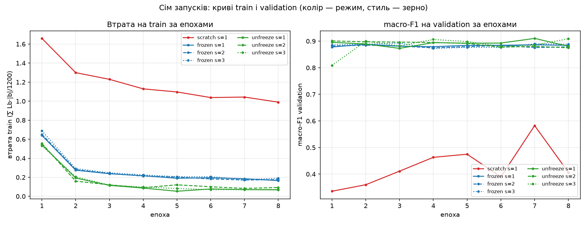
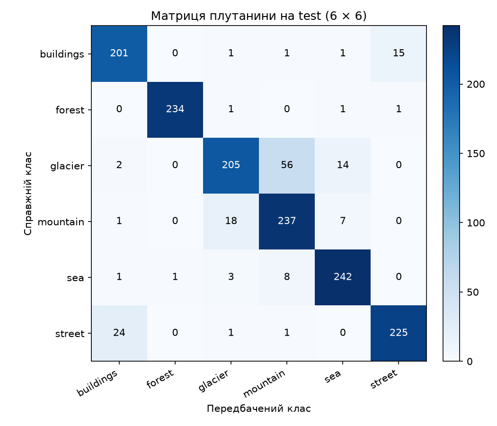
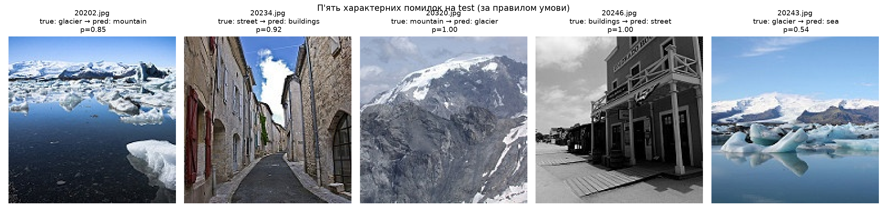

# Аналіз сім запусків ЛР3

## Таблиця семи запусків

| # | Режим | Зерно | Втрата train (ep8) | macro-F1 validation (ep8) | Train time, с | Total time, с |
|---:|---|---:|---:|---:|---:|---:|
| 1 | `scratch` | 1 | 0.9894 | 0.4067 | 30.0 | 58.2 |
| 2 | `frozen` | 1 | 0.1655 | 0.8842 | 24.6 | 50.5 |
| 3 | `frozen` | 2 | 0.1757 | 0.8785 | 26.5 | 54.2 |
| 4 | `frozen` | 3 | 0.1896 | 0.8886 | 24.7 | 51.1 |
| 5 | `unfreeze` | 1 | 0.0682 | 0.8808 | 24.9 | 50.5 |
| 6 | `unfreeze` | 2 | 0.0931 | 0.8750 | 25.8 | 52.1 |
| 7 | `unfreeze` | 3 | 0.0725 | 0.9093 | 25.2 | 51.1 |

## Розклад ефектів

| Величина | Значення (частка) | У пунктах ×100 |
|---|---:|---:|
| F̄_frozen | 0.8838 | 88.38 |
| R_frozen | 0.0101 | 1.01 |
| F̄_unfreeze | 0.8884 | 88.84 |
| R_unfreeze | 0.0343 | 3.43 |
| R = max(R_frozen, R_unfreeze) | 0.0343 | 3.43 |
| F_scratch,1 | 0.4067 | 40.67 |
| Δpre = F̄_frozen − F_scratch,1 | 0.4771 | +47.71 п.п. |
| Δunf = F̄_unfreeze − F̄_frozen | 0.0046 | +0.46 п.п. |
| Δpre + Δunf (сума) | 0.4817 | +48.17 п.п. |

**Правило:** якщо `|Δ| ≤ R`, різниця не відрізняється від розкиду. Якщо `|Δ| > R`, ефект вартий перевірки.

- Δpre: ефект вартий перевірки (|Δ| > R)
- Δunf: не відрізняється від розкиду (|Δ| ≤ R)

## Перевірка вибору

- Правило → **unfreeze / seed=3**, F_r,s = 0.9093
- `lab3_model.pt`: regime=`unfreeze`, seed=3, classes_ok=True, img_size_ok=True
- meta у `lab3_model.pt` відповідає правилу: **True**
- Ваги `lab3_model.pt` ідентичні `runs/unfreeze_seed3/model.pt`: **True**

**|Δunf| = 0.0046 ≤ R = 0.0343** — вибір між `frozen` і `unfreeze` визначив шум; процедура від цього не змінюється, але це треба назвати.

## Тестова оцінка (CPU, один раз)

- Модель: `unfreeze / seed=3`
- `macro-F1` на test = **0.8970**
- accuracy p на test = 0.8948; `SE_test = √(p(1−p)/n)` з n = 1502: **0.0079**
- accuracy p на validation (та сама модель): 0.9085; `SE_val` з n = 1498: **0.0074**
- стандартна похибка різниці: `SE_diff ≈ √(SE_test² + SE_val²)` = **0.0109**
- F_r,s (validation) обраного запуску = 0.9093; macro-F1 test − validation = **-0.0123** (≈ 1.1·SE_diff)
- оцінка оптимістичного зміщення від вибору найкращого з 3: `F_{unfreeze,3} − F̄_unfreeze` = **+0.0209**

**Інтерпретація.** Оптимістичне зміщення вибору «найкращого з трьох» (≈ `+0.0209`) того самого порядку, що й шум двох скінченних вибірок (`SE_diff ≈ 0.0109`). Тому в конкретному розбитті воно може бути непомітним або навіть мати протилежний знак: validation і test — різні вибірки зображень (різні 1498 і 1502 файли з `seg_test`), кожна зі своїм шумом. Виміряна різниця ≈ 1·SE_diff — у межах очікуваного шуму. SE частки (accuracy) тут — лише груба оцінка шуму для macro-F1, бо macro-F1 рахується поклассно й усереднюється по 6 класах, а SE виведено для скалярного біноміального питання «правильно чи ні».

### Матриця плутанини (рядки — справжній клас, стовпці — передбачений)

| | `buildings` | `forest` | `glacier` | `mountain` | `sea` | `street` |
|---|:---:|:---:|:---:|:---:|:---:|:---:|
| **`buildings`** | 201 | 0 | 1 | 1 | 1 | 15 |
| **`forest`** | 0 | 234 | 1 | 0 | 1 | 1 |
| **`glacier`** | 2 | 0 | 205 | 56 | 14 | 0 |
| **`mountain`** | 1 | 0 | 18 | 237 | 7 | 0 |
| **`sea`** | 1 | 1 | 3 | 8 | 242 | 0 |
| **`street`** | 24 | 0 | 1 | 1 | 0 | 225 |

## П'ять характерних помилок на test

| Файл | Справжній клас | Передбачений клас | Імовірність передбаченого | Кількість таких помилок у test |
|---|---|---|---:|---:|
| `20202.jpg` | glacier | mountain | 0.848 | 56 |
| `20234.jpg` | street | buildings | 0.924 | 24 |
| `20320.jpg` | mountain | glacier | 0.998 | 18 |
| `20246.jpg` | buildings | street | 1.000 | 15 |
| `20243.jpg` | glacier | sea | 0.537 | 14 |

